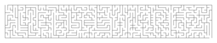

# Message Maze

A maze whose solution traces a hidden message. Designed for the [Blot pen plotter](https://github.com/hackclub/blot), combining reusable letter paths with random maze branches to make personalized, solvable drawings.

**Upstream contribution:** the original Message Maze artwork was [merged into Hack Club's Blot repository in PR #621](https://github.com/hackclub/blot/pull/621). This repository contains the original Python-backed version and the later JavaScript port.



## Generate a drawing locally

Node.js 20+; no packages, API keys, Python server, or network calls required for the SVG exporter.

```sh
node scripts/export-svg.js "HELLO WORLD" hello-world.svg
npm test
```

Open the SVG in your browser or import it into a vector/plotting tool. Start at the opening in the top-left cell and follow the maze to the opening on the bottom edge. Outputs are random, so successive drawings differ. Existing output files are never overwritten silently; choose a new filename.

Messages accept A–Z and spaces, up to **30 characters after normalization**. Lowercase is converted to uppercase; punctuation and digits become spaces. Empty messages are rejected. Words wrap at 14 characters where possible, with long words kept intact.

## Draw with Blot

1. Open the [Blot editor](https://blot.hackclub.com/editor).
2. Paste `V2/index.js` into the editor.
3. Change `drawMazeFromString("HELLO")` at the bottom to your message and run it.
4. Inspect dimensions and the generated preview before plotting.

The standalone Blot script downloads letter patterns from `V2/assets/patterns` on this repository's `main` branch, so this route requires an internet connection. The local SVG exporter loads the same assets from disk and uses the same generation algorithm. A maintenance PR's local changes become available to that hosted script after merging.

## How it works

1. Normalize the phrase and arrange letters into rows.
2. Load each letter's predesigned solution path and insert separator/space patterns.
3. Join rows in alternating directions, adding randomized padding paths.
4. Grow maze branches around the protected message path.
5. Render walls as Blot turtle strokes or an SVG with an entrance and exit.

The tests check letter availability, word preservation, reciprocal walls, whole-maze connectivity, and continuity of the protected solution, including multi-line messages. They also cover invalid input and asset-download errors. CI generates a downloadable SVG artifact.

## Repository map

| Path | Purpose |
| --- | --- |
| `V2/index.js` | Current JavaScript generator and Blot entry point |
| `V2/assets/patterns/` | Letter, separator, and space patterns |
| `scripts/export-svg.js` | Dependency-free local SVG exporter |
| `V1/` | Historical FastAPI/Python implementation, drawing tools, and snapshots |
| `V2/temp.js` | Historical development experiment; use `V2/index.js` |

The V1 Python implementation is retained for its algorithm history. Its pickle assets are project data; use only trusted files when running that legacy workflow. New development should start with V2.

[MIT License](LICENSE). Built by [Bodha](https://github.com/iambodha), with thanks to the Hack Club Blot community.
